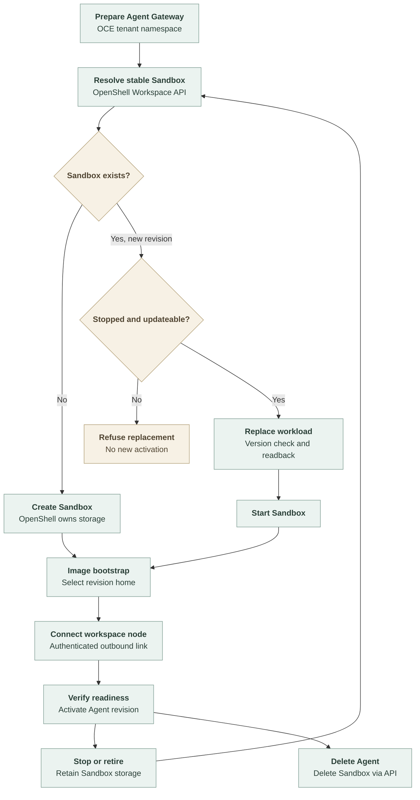

# Managed OpenShell workload flow

## Overview

The experimental Kubernetes + OpenShell Compute Driver keeps one Sandbox per
Agent across revisions. An Agent deployment triggers shared Kubernetes Gateway
preparation and OpenShell workload reconciliation. OpenShell owns Harness storage
in a managed namespace; OCE manages Gateway resources in its tenant namespace.
This trace covers implemented prototype code, not verified cluster behavior.

## Entry Points

- `apps/controller/src/composition/installation-config.ts:loadInstallationConfiguration`
  selects the managed Compute implementation and Sandbox collaborator when bundled
  Kubernetes Compute is paired with bundled OpenShell Sandbox in managed mode.
  It preserves the configured Compute ID and records `occ/kubernetes-openshell`
  as the implementation; operator mode retains `occ/kubernetes`.
- `apps/controller/src/drivers/compute/kubernetes/index.ts:prepareRevision`
  receives the authorized Agent revision and prepares the Gateway.
- `apps/controller/src/drivers/compute/kubernetes-openshell/managed-sandbox.ts:reconcileHarness`
  creates or updates the Agent's Sandbox through its Backend.

Assumptions: one worker, dedicated Harness, managed OpenShell Workspaces and the
expanded workload-update RPC. See [configuration and limits](../reference/drivers/kubernetes-openshell-compute.md).

## Flow

The same revision can be adopted after a lost response. The diagram omits that
retry edge. A failed update readback does not reach `StartSandbox`.

## Execution Trace

### 1. Prepare the Workspace and Gateway

`apps/controller/src/drivers/compute/kubernetes-openshell/managed-sandbox.ts:ensureNamespace`
creates or verifies the owned logical
Workspace through OpenShell. It applies no Kubernetes resources there.
`KubernetesComputeDriver.prepareRevision` retains Gateway orchestration and
skips Harness PVC creation when `workspaceStorage` is `provider`.

`KubernetesComputeDriver.harnessLaunch` builds command, environment, identity and
retained-directory requirements from prepared Agent inputs. `harnessLaunchWithNode`
adds node startup and retained identity when enrollment is selected. Kubernetes
uses this description for its container and mounts. `sandboxRequirements` passes
logical directories and an empty `workspaceMounts` list to managed OpenShell;
provider preparation and activation do not render a Harness Deployment.

`ManagedOpenShellSandbox.harnessSpec` maps named directories to image-bootstrap
inputs. Explicit directory environment bindings select workspace and node-state
paths; an unrelated variable with the same value does not select retained state.
The shared `OpenShellSandboxDriver.harnessSpecForLayout` adds process, network and
Provider settings without constructing operator PVCs. The managed implementation
supplies its own filesystem and runtime-class/resource configuration.

### 2. Reconcile a stopped workload

`ManagedOpenShellSandbox.ensureRuntimeProvider` uses an Agent-derived Provider
name. A new revision replaces its material only while the Sandbox is stopped.
Same-revision retries permit the existing restricted setup-envelope renewal.
Credential updates precede a fresh Provider read and version-checked config write.

`reconcileHarness` verifies Namespace and Agent ownership, then requires stopped
state before changing the revision. It rejects unsupported immutable differences,
sends `SandboxUpdates.UpdateSandbox` with the observed resource version and reads
back the complete specification. Only a matching result can start. The client
uses the separate service path in `openshell-gateway-client.ts:updateSandbox`.

### 3. Select storage paths and connect the node

`deploy/runtime/openshell-bootstrap.cjs:prepareManaged` creates process-owned
retained directories and a revision home before the Harness loader runs. It
validates existing paths, creates home-relative links and atomically replaces
the runtime selector symlink. Old homes remain until Agent deletion.

`KubernetesComputeDriver.workspaceNodePeers` pairs the managed namespace labels
with the gateway-issued Sandbox supervisor ID. `providerHarnessReady` reads
OpenShell lifecycle state. Existing transport and node-enrollment checks still
gate activation.

`OpenShellSandboxDriver.initializeWorkspace` waits for supervisor readiness,
then verifies the setup Secret's Namespace, Agent and setup identifiers in OCE's
tenant namespace. `ManagedOpenShellSandbox.workspaceInitializationPath` selects
`/sandbox/oce/workspace` without requiring a PVC mount. The initializer uses the
bootstrap's selected revision home through `/sandbox/.openclaw-runtime/home`.
Operator mode still requires an approved PVC mount. Both paths deliver the
payload through authenticated `ExecSandbox` stdin, including completed setup
records on retries and later revisions. See
[workspace initialization](workspace-files.md#2-deployment-initializes-storage-before-execution).

### 4. Retain or delete

`apps/controller/src/drivers/compute/kubernetes-openshell/managed-sandbox.ts:cleanup`
ignores retirement for an older revision after
replacement. For the current revision it calls `StopSandbox` and confirms stopped
state. It does not delete storage. OpenShell stop/start lacks a generation
precondition, so these checks cannot fence an in-flight stale request.

`KubernetesOpenShellComputeDriver.deleteAgentRuntimeCredentials` resolves the
tenant's Kubernetes namespace name, deletes the owned Sandbox and runtime Provider
through OpenShell, then performs shared Gateway cleanup. Namespace cleanup removes
unused runtime profiles and the Workspace. No Harness PVC call is made by OCE.

## Debugging and Verification

Run the [local checks and deferred cluster checklist](../testing/openshell.md#managed-compute-prototype).
A missing image bootstrap fails launch. Incorrect namespace labels block the
workspace-node connection. Unsupported or incomplete workload updates leave the
Sandbox stopped and the revision inactive. Local protocol and filesystem checks
do not establish cluster isolation or durable replacement after failures.

## Related docs

- [Prototype configuration](../reference/drivers/kubernetes-openshell-compute.md)
- [Ordinary OpenShell provisioning](openshell-sandbox-provisioning.md)
- [Investigation plan](../../specs/plans/0048-openshell-managed-workspace-investigation.md)

## Manual Notes

## Changelog

- 2026-10-23 20:15: Fix managed workspace initialization path selection. (authoring-run/4e502b3d-c986-4244-9d04-1665d6f223ac - c95d57168)

- 2026-10-23 13:17: Describe direct Harness inputs. (authoring-run/2c3f5532-2023-4496-954f-df02d9be44c1 - bd4948208)

- 2026-10-22 12:52: Trace the uncommitted managed Compute prototype. (authoring-run/614bce75-0da5-4656-b1c3-6e8fc1740729 - 0505bb60ea905e4fe011616b41e5d1dcfc369bb4)
